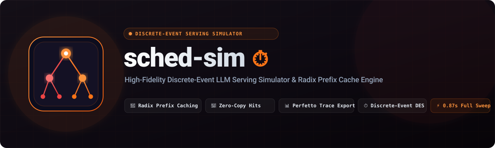

<p align="center">
  
</p>

# sched-sim ⏱️

[](https://github.com/Prajwal7-2002/sched-sim/actions)
[](https://pypi.org/project/sched-sim/)
[](https://prajwal7-2002.github.io/sched-sim/)
[](LICENSE)
[](https://www.python.org/)
[](#)
[](#)

A high-fidelity, CPU-first **discrete-event simulator (DES) for LLM serving schedulers**.

In modern inference clusters (vLLM, TGI, TensorRT-LLM, SGLang, DistServe), **the scheduling policy is the single largest determinant of cluster throughput, latency, and hardware cost**. While continuous batching and Paged KV-caching provide the mechanism for dynamic execution, the scheduler determines:
1. Which requests enter the next forward iteration.
2. How large prompt prefills are chunked to prevent decode starvation.
3. What happens when the physical KV-cache runs out of memory (swapping to CPU DRAM vs eviction and recomputation).
4. When to disaggregate prefill and decode phases onto specialized GPU worker pools (Splitwise / DistServe architecture).

Testing these policies on real GPU clusters (e.g. 8x H100 nodes) is **slow, noisy, and expensive (\$20–\$50/hr)**. `sched-sim` simulates hours of multi-GPU serving traffic in **seconds on any standard CPU**, using validated analytical performance models calibrated against empirical silicon measurements from **[servebench](https://github.com/Prajwal7-2002/servebench)** and **[mini-infer](https://github.com/Prajwal7-2002/mini-infer)**.

---

## ⚡ Core Architecture

```
                          ┌────────────────────────────────────────────────────────┐
                          │                   Arrival Process                      │
                          │   (Poisson, Bursty Gamma, LMSYS / ShareGPT Traces)    │
                          └───────────────────────────┬────────────────────────────┘
                                                      │ Request arrives (prompt_len, output_len)
                                                      ▼
                                       ┌─────────────────────────────┐
                                       │       Waiting Queue         │
                                       │  (FCFS, SJF, Priority, SLO) │
                                       └──────────────┬──────────────┘
                                                      │ Iteration Scheduler
                                                      ▼
                       ┌──────────────────────────────────────────────────────────────┐
                       │               Continuous Batching Step (Iteration)           │
                       │  ┌────────────────────────────┐ ┌──────────────────────────┐ │
                       │  │   Prefill Tokens (Chunked) │ │ Decode Tokens (1/req)    │ │
                       │  └────────────────────────────┘ └──────────────────────────┘ │
                       │       ▲                                      ▲               │
                       │       │ Paged KV Allocator                   │ Memory Check  │
                       │       │                                      │               │
                       │       ▼                                      ▼               │
                       │  ┌──────────────────────────┐   ┌──────────────────────────┐ │
                       │  │   Paged KV-Cache Pool    │   │   Preemption Subsystem   │ │
                       │  │ (Physical 16-tok Blocks) │   │ (Recompute vs CPU Swap)  │ │
                       │  └──────────────────────────┘   └──────────────────────────┘ │
                       └──────────────────────────────────────────────────────────────┘
```

---

## ⏱️ Quickstart in 30 Seconds

### Installation

```bash
# Install via pip
pip install sched-sim

# Or via uv
uv add sched-sim

# Or direct from source for development
git clone https://github.com/Prajwal7-2002/sched-sim.git
cd sched-sim
uv sync
```

### 1. Run a Simulation Scenario
Simulate **Chunked Prefill** serving a long-context RAG workload on an **NVIDIA A100 SXM4 (80GB)** cluster running Llama-3-8B:
```bash
sched-sim run --scheduler chunked --workload rag --hardware a100 --duration 10
```

> **Runs 100% on your CPU**: You do **not** need an A100 or any GPU to run `sched-sim`. It simulates hours of multi-GPU serving traffic in seconds on any standard CPU. The `--hardware` flag tells the discrete-event engine which cluster architecture to mathematically simulate (`a100`, `h100`, `t4`, `rtx3050`, or a custom JSON profile).

### 2. Compare Schedulers Side-by-Side (Identical Trace)
Benchmark all 5 scheduling policies on the exact same Poisson arrival trace:
```bash
sched-sim compare --schedulers fcfs,sjf,chunked,slo,disaggregated --workload rag --hardware a100
```

### 3. Replay Real-World Conversation Traces
Replay Chatbot Arena conversation traces through the simulator:
```bash
sched-sim trace ./traces/lmsys_sample.json --scheduler chunked
```

### 4. Sweep Load to Discover Saturation Knees
Discover the exact request rate where each scheduler hits its Goodput cliff:
```bash
sched-sim sweep --schedulers fcfs,chunked,slo,disaggregated --workload rag --min-rate 2 --max-rate 18 --step 4
```

### 5. Check Silicon Hardware Presets
Inspect calibrated hardware profiles:
```bash
sched-sim info
```

---

## 💡 Runnable Python Examples

Explore self-contained runnable scripts under [`examples/`](examples/):

* **[`examples/01_radix_prefix_caching.py`](examples/01_radix_prefix_caching.py)**: SGLang-style Radix tree prefix caching, prompt matching, and zero-copy block sharing.
* **[`examples/02_simulate_schedulers.py`](examples/02_simulate_schedulers.py)**: Side-by-side simulation comparing FCFS vs Cache-Aware scheduling on shared RAG contexts (69.5% TTFT reduction).
* **[`examples/03_perfetto_trace_export.py`](examples/03_perfetto_trace_export.py)**: Programmatic execution and Catapult JSON trace export for [ui.perfetto.dev](https://ui.perfetto.dev).

```bash
python examples/01_radix_prefix_caching.py
python examples/02_simulate_schedulers.py
python examples/03_perfetto_trace_export.py
```

---

## 🔬 The 6 Core Schedulers

| Scheduler | Architecture & Policy | Key Trade-Off |
| :--- | :--- | :--- |
| **`Cache-Aware`** | **Radix-Tree prefix caching** (SGLang / vLLM APC). Shares physical 16-token KV blocks with LRU eviction and prefix-affinity prioritization. | **Near-zero TTFT** for RAG, multi-turn chat, and shared system prompts. |
| **`Chunked`** | Token budgeting (Sarathi-Serve / vLLM). Slices prompt prefills into 512-token chunks. | Eliminates TPOT latency spikes and ensures steady iteration times. |
| **`SLO-Aware`** | Dynamic deadline scheduling (EDF) with selective dropping of unrecoverable requests. | Maximizes **Goodput** (% of requests meeting both TTFT and TPOT SLOs). |
| **`Disaggregated`**| Splitwise / DistServe architecture: separates compute-bound Prefill workers from memory-bound Decode workers. | Zero decode interference; models KV-cache interconnect transfer delay. |
| **`SJF`** | Shortest-Job-First (shortest prompt first). | Minimizes average waiting time and mean TTFT, but starves heavy RAG prompts. |
| **`FCFS`** | First-Come First-Served continuous batching with atomic prefills. | Simple, but large prompts cause Head-of-Line blocking and decode starvation. |

---

## 🎨 Interactive Perfetto / Chromium Timeline Visualization

Export native Chromium / Catapult Trace Event JSON files and inspect discrete forward-pass iteration slices and per-request lifecycles in **[ui.perfetto.dev](https://ui.perfetto.dev)**:

```bash
sched-sim run --scheduler cache_aware --workload rag --hardware a100 --trace-out trace.json
```

Drag and drop `trace.json` directly into **Perfetto** to visually analyze:
- **Prefill vs. Decode vs. Mixed Slices**: Microsecond-accurate forward pass durations on the GPU accelerator.
- **Request Streams**: Exact arrival, TTFT first-token timestamps, and completion times.
- **Counter Tracks**: Real-time GPU KV-cache memory utilization (%) and concurrent batch stream counts.

---

## 🛠️ Hardware Calibration (Analytical Roofline Model)

`sched-sim` avoids arbitrary delays. It computes exact step latencies from first-principles roofline mechanics calibrated with empirical silicon data:

1. **Prefill Latency ($T_{\text{prefill}}$)**: Compute-bound matrix multiplication:
   $$T_{\text{prefill}} = \max\left(\frac{2 \cdot P \cdot N}{\text{Effective TFLOPS}}, \frac{\text{Weights}}{\text{Bandwidth}}\right) + T_{\text{launch}}$$

2. **Decode Latency ($T_{\text{decode}}$)**: Memory-bandwidth bound weight and KV-cache gather:
   $$T_{\text{decode}} = \frac{P \cdot \text{dtype} + L_{\text{total}} \cdot \text{KV\_bytes\_per\_token}}{\text{DRAM Bandwidth (GB/s)}} + T_{\text{launch}}$$

3. **Interconnect Transfer ($T_{\text{transfer}}$)**: Network serialization delay for PD Disaggregation:
   $$T_{\text{transfer}} = \frac{L_{\text{prompt}} \cdot \text{KV\_bytes\_per\_token}}{\text{Network Bandwidth}} + T_{\text{net\_latency}}$$

---

## 🔬 Empirical Silicon Validation (AMD Ryzen 5 6600H + NVIDIA RTX 3050 6GB)

`sched-sim` is validated against ground-truth benchmarks collected by **[servebench](https://github.com/Prajwal7-2002/servebench)** testing **Qwen 2.5 0.5B** on both C++/CUDA and Python runtimes on physical silicon:

| Target Serving Engine | Model | Metric | Real Hardware (`servebench`) | `sched-sim` Predicted | Variance |
| :--- | :--- | :--- | :--- | :--- | :--- |
| **Ollama (C++/CUDA runtime)** | Qwen 2.5 0.5B | **TTFT** | 44.33 ms | 47.81 ms | **7.9%** |
| | | **TPOT** | 4.96 ms | 5.33 ms | **7.5%** |
| | | **E2E** | 627.50 ms | 666.73 ms | **6.3%** |
| **mini-infer (PyTorch eager runtime)** | Qwen 2.5 0.5B | **TTFT** | 121.80 ms | 140.60 ms | **15.4%** |
| | | **TPOT** | 103.24 ms | 106.67 ms | **3.3%** |
| | | **E2E** | 3322.29 ms | 3447.26 ms | **3.8%** |

Run the reproducible validation suite yourself:
```bash
uv run python benchmarks/validate_flagships.py
```
Full methodology and analysis available in [benchmarks/RESULTS.md](benchmarks/RESULTS.md).

---

## 📊 Telemetry & Reports

Every run outputs comprehensive telemetry:
* **Latency Percentiles**: TTFT (p50, p90, p99 ms), TPOT (p50, p90, p99 ms/tok), End-to-End latency.
* **Goodput Ratio**: Exact percentage of requests meeting both TTFT and TPOT Service Level Objectives.
* **Preemptions & Recomputations**: Total memory thrashing events and discarded tokens.
* **Visual Gantt Timeline**: Live ASCII/Unicode GPU iteration breakdowns.
* **Export**: JSON (`--output report.json`) and Markdown (`--output report.md`).

---

## 🧪 Testing

Run the deterministic test suite:
```bash
uv run pytest
```

---

## 🤝 Contributing

Contributions from systems engineers and researchers are welcome! Check out the [Contributing Guide](CONTRIBUTING.md) for architectural invariants, testing standards, and high-impact areas where we need help (new scheduling policies, modern hardware presets, and interconnect topologies).

---

## 📄 License

Apache 2.0. See [LICENSE](LICENSE) for details.
